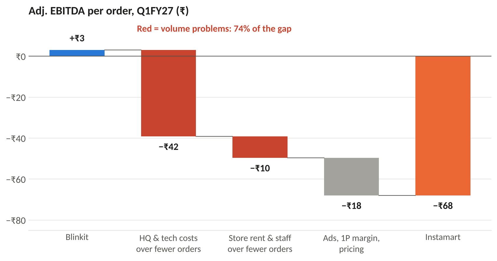
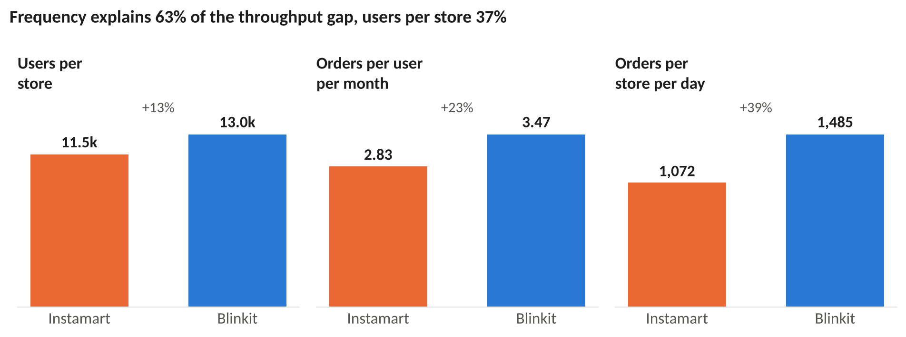
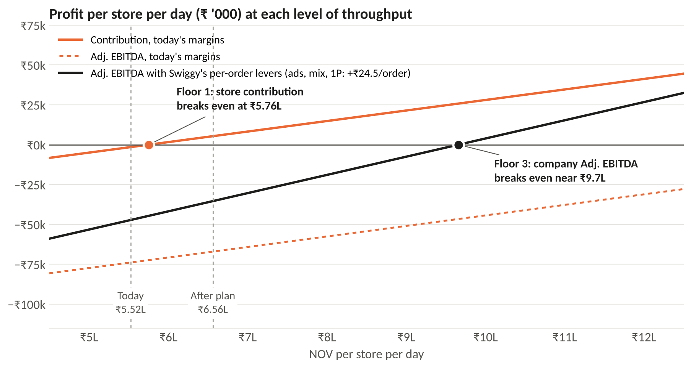
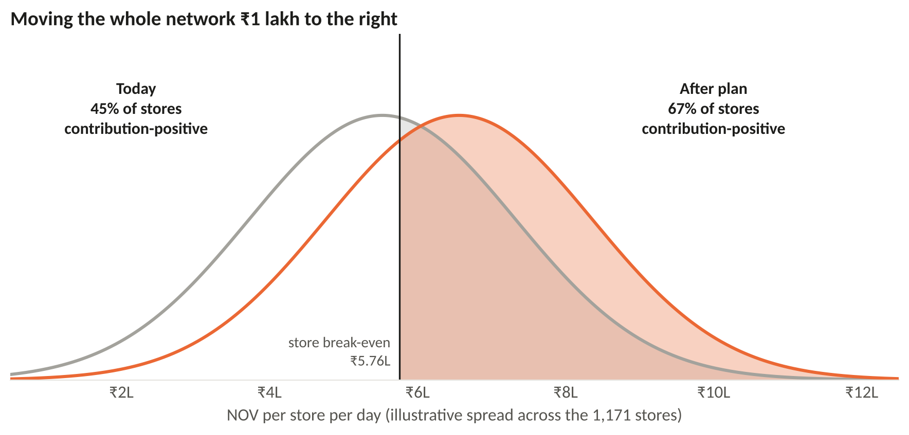
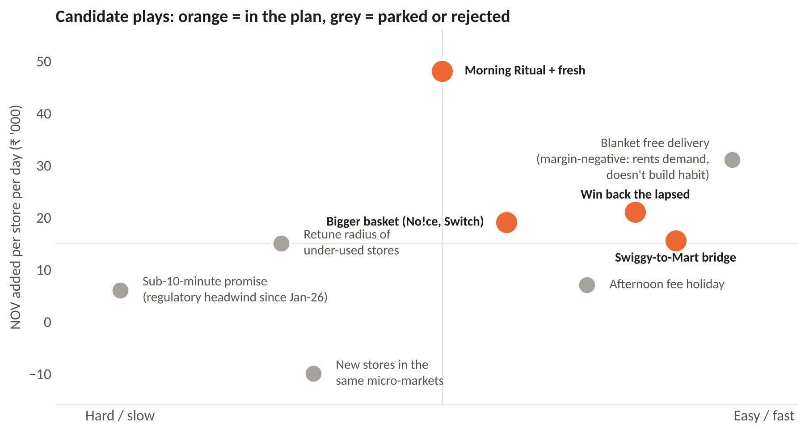
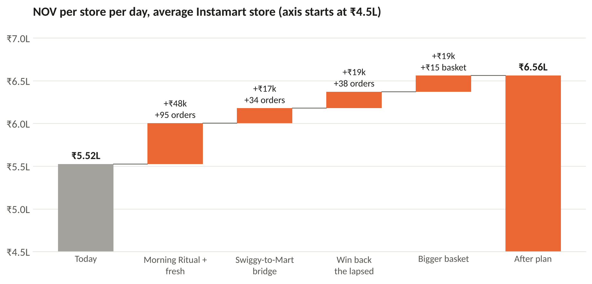
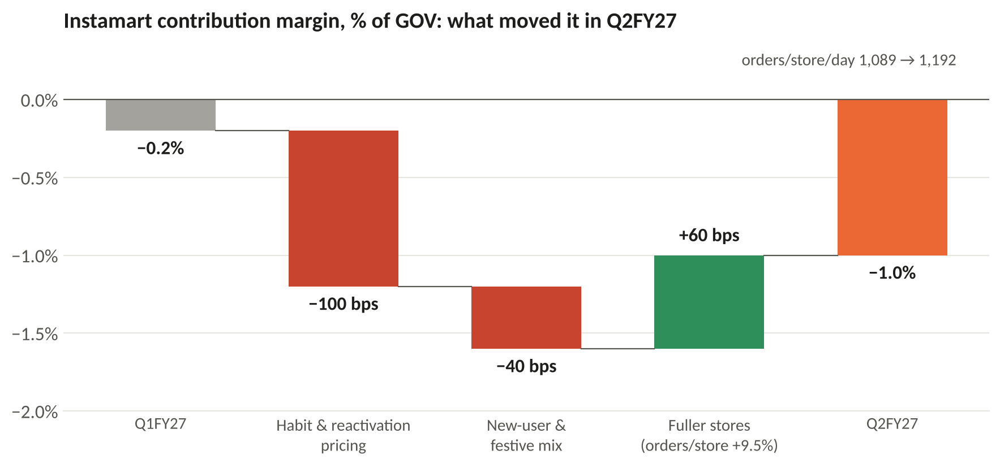

# Fill the stores before you build more
**A densification plan for Swiggy Instamart: +₹1 lakh NOV per dark store per day, and what that does to break-even**

Arnav Deshpande · arnavhpd@gmail.com

The deck is [`Instamart_Densification_Plan.pdf`](Instamart_Densification_Plan.pdf) (19 slides, also as `.pptx`). This page is the short version.

Baseline is Q1FY27 (quarter to 30 June 2026), the same quarter as the rest of this repo, and every number is pulled from `../data` through `../metrics.py`. Nothing in the parent project is modified.

---

## The answer
Instamart's problem isn't its basket, it's its stores. An Instamart order is worth almost exactly what a Blinkit order is (₹508 vs ₹518 net), but an Instamart store sells **₹5.5L a day against Blinkit's ₹8.0L**, and it runs at about 40% of capacity.

Adding **₹1 lakh of NOV per store per day on the 1,171 stores that already exist** does three things:

| | Before | After |
|---|---|---|
| Contribution margin, % of NOV | −0.3% | **+0.8%** |
| Stores that cover their own rent and staff | 45% | **~67%** |
| Stores needed to reach Swiggy's ₹60,000 Cr break-even scale | 2,975 | **2,505** (~470 fewer, ~₹1,200 Cr of capex) |

That's about ₹4,400 Cr of extra NOV a year and ~₹220 Cr of net contribution after paying for the programme.

It does **not** make Instamart EBITDA-positive on its own. That needs roughly ₹9.7L per store per day *and* the per-order levers Swiggy has already announced (ads, mix, the inventory model). The ₹1 lakh is the first and cheapest part of that climb, and it's the part that doesn't need new stores.

## 1. Where the loss comes from


Blinkit makes +₹3 per order; Instamart loses ₹68. Of that ₹71 gap, **₹52 (74%) is volume**: HQ, tech and brand costs that are about the same in rupees for both companies, and store rent and staff, spread over far fewer orders. Only ₹18 is a true per-order margin gap.

## 2. Why there are so few orders


Orders per store per day = users per store × how often each one orders. **Frequency is 63% of the gap** (2.83 orders a month vs 3.47). Five whys gets to the root cause: Instamart opened 316 stores in a single quarter (Q4FY25) into neighbourhoods that hadn't formed the habit yet, then cut ~4M low-value users. Capacity ran ahead of demand.

## 3. What break-even actually means


I split each store's day into a variable margin (6.6% of NOV) and a fixed block for rent and staff (₹38k). Two independent estimates land on that ₹38k, explained in `model.py`. That gives three floors:

1. **Network contribution ≥ 0.** The average store needs ₹5.76L a day. Swiggy touched this for one month (May 2026). The plan holds it.
2. **Most stores in the black.** 45% → ~67%.
3. **Company Adj. EBITDA ≥ 0.** ~₹9.7L a day once Swiggy's own per-order levers land.



## 4. The plan
I designed the fix with **CIRCLES**, starting from one store's catchment (~11.5k monthly users), and measured it with **HEART**.



| Play | What it is | ₹/store/day |
|---|---|---|
| Morning Ritual + fresh | Milk, bread, eggs, curd and a fruit-and-veg box on a 6–9 am batched slot, the quietest hours for a dark store. Scale Nectr with a replacement promise. | +₹48k |
| Swiggy-to-Mart bridge | 12.7M people use Swiggy each month but not Instamart. Offer tomorrow's milk on the food-tracking screen. | +₹17k |
| Win back the lapsed | ~4 in 10 new users don't return in month one. Fix the reason (stock-out, late, price), not just send a coupon. | +₹19k |
| Bigger basket | Private label, recipe add-ons, Maxxsaver thresholds set per store. +₹15 net AOV. | +₹19k |



Rejected: blanket free delivery (adds orders but rents demand, and Blinkit can match it the next day), a faster promise (regulatory headwind since January 2026), and new stores in micro-markets that are already served.

**HEART scorecard.** North star: NOV per store per day. Happiness: fresh complaints per 1,000 orders. Engagement: orders per user per month, 2.83 → 3.08. Adoption: share of users on Morning Ritual; share of food-only users trying Instamart. Retention: M1 61% → 65%. Task success: fill rate on top-200 SKUs ≥ 98%, morning on-time ≥ 95%. Guardrails: ≥ ₹20 contribution per added order, no worse peak-hour SLA, no drop in rider earnings per hour.

## 5. How I'd test it
60 pilot stores against 60 matched controls (same city, store age, sales band), randomised at store level because the plays change store capacity. Read difference-in-differences on NOV per store per day with CUPED on the 8-week pre-period. Scale to the top 8 metros only if pilot stores are ≥ ₹40k a day ahead by day 120. **Stop** if they're under ₹20k, or if added orders earn less than ₹10 of contribution each.

## 6. What happened next
Swiggy's Q2FY27 results came out in October 2026, after the baseline. Orders per store rose 9.5% and Swiggy credits that with +60 bps of contribution, the density lever working. But 100 bps went on pricing, 40 bps on mix, and 69 new stores opened, so contribution fell to −1.0%.



## What I'm least sure about
- **The ₹38k store-cost split.** Swiggy doesn't publish it. The tests check that contribution still ends positive anywhere from ₹30k to ₹45k, and at half the planned uplift.
- **The spread of store throughput** (σ = ₹1.8L) is picked to reproduce Swiggy's "45% of stores CM-positive". Real store-level data would replace it.
- **Play sizes** are my estimates. They're all in one place (`PLAYS` in `model.py`) so anyone can change them and rebuild.
- Capex per store uses Blinkit's guided ₹2.5 Cr; Instamart doesn't disclose its own.

## Rebuild it
```bash
cd densification-strategy
python model.py          # prints every number in the deck
python charts.py         # redraws charts/
python build_deck.py     # writes the .pptx (needs python-pptx)
python -m pytest -q      # headline numbers, including the downside cases
```

## Sources
Swiggy shareholder letters Q1FY26–Q2FY27; Eternal shareholder letters Q3FY25–Q2FY27; Zepto abridged UDRHP (SEBI, June 2026); Business Standard on dark-store additions (Aug 2026); TechCrunch on the 10-minute directive (Jan 2026); Fisher Phillips on India's labour codes. Q2FY27 figures used in the postscript are in [`data/q2fy27_postscript.csv`](data/q2fy27_postscript.csv) with links. Case structure follows the profitability-tree approach in the IIM Ahmedabad Consult Prep Book 2025–26.

Independent analysis of public filings; not affiliated with Swiggy, Eternal or Zepto.
