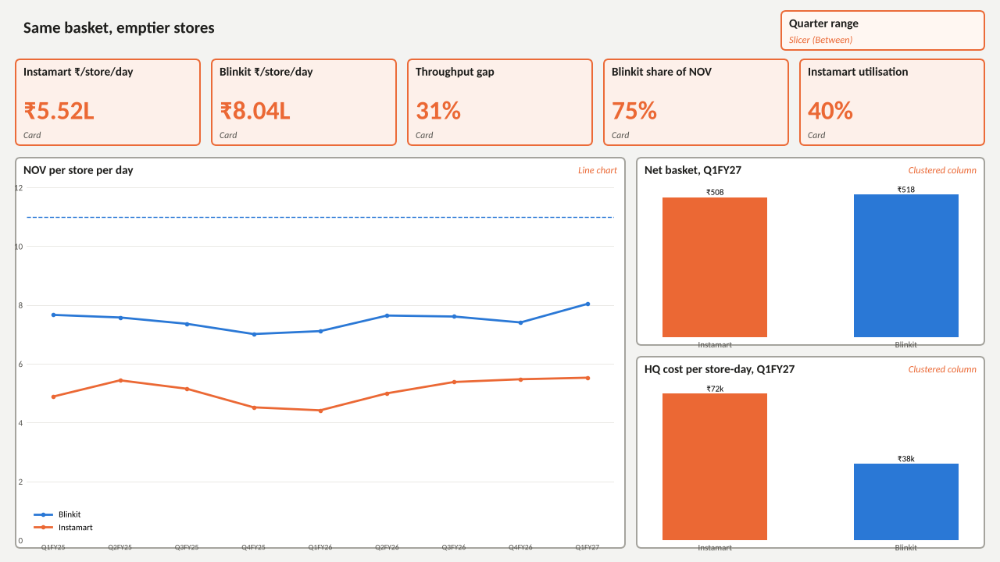
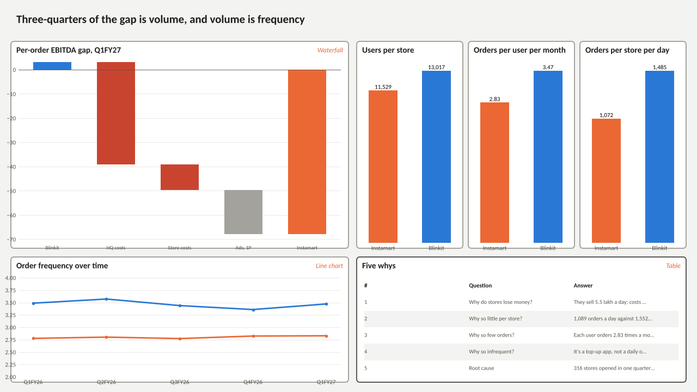
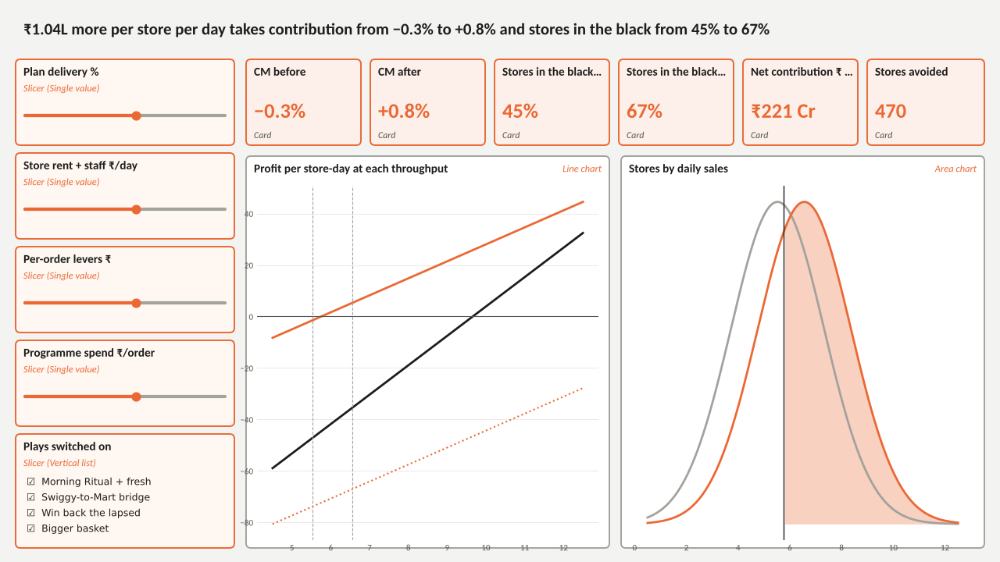
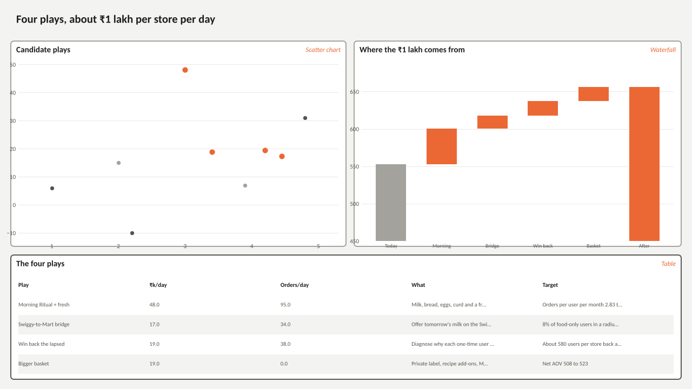
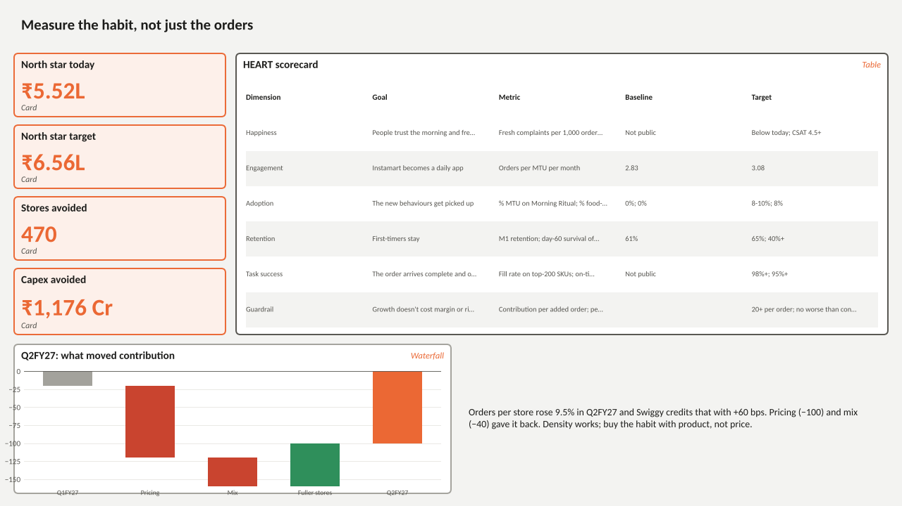

# Instamart densification dashboard: build guide

Five pages that tell the same story as the deck, plus a simulator where you can move the assumptions and watch break-even move. Plan on 1.5 to 2 hours in Power BI Desktop the first time.

| Page | Question it answers |
|---|---|
| 1 Market | Is Instamart's problem the basket or the stores? |
| 2 Root cause | Where does the per-order loss come from, and why are stores emptier? |
| 3 Simulator | What does ₹1 lakh more per store per day do to break-even, and how sure are we? |
| 4 The plan | Which plays, how much each adds |
| 5 Scorecard | How we'd know it's working (HEART), and what Q2FY27 already shows |

**You need:** Power BI Desktop (free, Windows). On a Mac, run it in a Windows VM; the web version can't create what-if parameters.

**Files in this folder**

| File | What it is |
|---|---|
| `data/*.csv` | The 11 tables the report loads. Rebuild them with `python export_powerbi.py`. |
| `measures.dax` | Every measure, in the order this guide adds them, with format strings. |
| `instamart_theme.json` | Colours and fonts. |
| `mockups/page_*.png` | What each page should look like at default settings. |

---

## Step 1. Load the data
1. **Home > Get data > Text/CSV.** Load all 11 files in `data/`. Keep the file names as table names (`fact_quarterly`, `plays` and so on); the measures refer to them by name.
2. In **Transform data**, check the types, then **Close & Apply**:
   - `dim_quarter[QuarterEnd]`: Date
   - `plays[InPlan]`: True/False
   - Every other numeric column: Decimal number. `fact_quarterly` has blanks for Blinkit orders and users before Q1FY26. That's expected; leave them blank, not zero.

## Step 2. Relationships and sort orders
In **Model view**, make these relationships (one-to-many, single direction):

| From (one) | To (many) |
|---|---|
| `dim_quarter[Quarter]` | `fact_quarterly[Quarter]` |
| `dim_platform[Platform]` | `fact_quarterly[Platform]` |
| `dim_platform[Platform]` | `throughput[Platform]` |

Delete any relationship Power BI auto-detects between other tables. The small tables (`plays`, `heart`, `baseline` etc.) stand alone on purpose.

Then sort text columns so the visuals don't come out alphabetical (**Column tools > Sort by column**):

| Column | Sort by |
|---|---|
| `dim_quarter[Quarter]` | `SortOrder` |
| `per_order_gap[Step]` | `SortOrder` |
| `lever_stack[Step]` | `SortOrder` |
| `plays[Play]` | `SortOrder` |
| `heart[Dimension]` | `SortOrder` |
| `q2fy27_cm_bridge[Step]` | `SortOrder` |
| `throughput[Metric]` | `SortOrder` |

## Step 3. Theme
**View > Themes > Browse for themes** and pick `instamart_theme.json`. Orange is Instamart, blue is Blinkit, everywhere. If a visual colours the two platforms the other way round, fix it once in **Format > Lines / Columns > Colors**.

## Step 4. What-if parameters
**Modeling > New parameter > Numeric range.** Create four, with these exact names (the measures depend on them). Untick "Add slicer to this page"; you'll place the slicers on page 3.

| Name | Min | Max | Increment | Default | What it means |
|---|---|---|---|---|---|
| `Plan Delivery` | 0 | 150 | 5 | 100 | % of the planned uplift the plays actually deliver |
| `Store Cost` | 30000 | 45000 | 1000 | 38000 | Rent + staff per store per day, ₹ |
| `Per Order Levers` | 0 | 30 | 0.5 | 24.5 | ₹ per order from ads, mix and the inventory model |
| `Programme Spend` | 0 | 20 | 1 | 10 | ₹ spent per added order to run the plays |

Each one creates a table and a measure called `<Name> Value`, for example `'Plan Delivery'[Plan Delivery Value]`.

## Step 5. The x-axis table for the curves
**Modeling > New table**, paste:
```
NOV Grid = SELECTCOLUMNS ( GENERATESERIES ( 0, 13, 0.1 ), "NOV_Lakh", [Value] )
```

## Step 6. Measures
1. **Home > Enter data**, name the table `_Measures`, load it. Once it holds a measure, delete its `Column1`; the table moves to the top of the field list.
2. Open `measures.dax`. Paste each measure into **Modeling > New measure** with `_Measures` selected, in file order (later ones use earlier ones). Set the format shown in the `// format:` comment under each.
3. Optional: put sections into display folders (**Model view > Properties > Display folder**): Market, Baseline, Simulator, Curves, Text.

## Step 7. Build the pages
Canvas: **Format page > Canvas settings > 16:9** (1280 × 720). Type the x, y, w, h numbers into **Format > General > Properties > Size and position** to get the layout exactly; or just eyeball the mock-up.

<!-- pages:start -->
### Page 1 Market



| Visual | Type | x, y, w, h | Fields and settings |
|---|---|---|---|
| Page title | Text box | 20, 14, 900, 46 | Same basket, emptier stores. Segoe UI Semibold 22 |
| Quarter range | Slicer (Between) | 1000, 14, 260, 50 | dim_quarter[SortOrder] as a range; label it 'Quarter' |
| Instamart ₹/store/day | Card | 20, 76, 236, 110 | [Instamart NOV per Store-Day L] |
| Blinkit ₹/store/day | Card | 271, 76, 236, 110 | [Blinkit NOV per Store-Day L] |
| Throughput gap | Card | 522, 76, 236, 110 | [Throughput Gap %]  (31%) |
| Blinkit share of NOV | Card | 773, 76, 236, 110 | [Blinkit Share of NOV]; visual filter Quarter = Q1FY27  (75%) |
| Instamart utilisation | Card | 1024, 76, 236, 110 | [Utilisation Today]  (40%) |
| NOV per store per day | Line chart | 20, 202, 780, 500 | X dim_quarter[Quarter] (sorted by SortOrder), Y [NOV per Store-Day L], Legend dim_platform[Platform]. Analytics: constant line at 11, label 'Blinkit steady-state target' |
| Net basket, Q1FY27 | Clustered column | 815, 202, 445, 240 | X dim_platform[Platform], Y [Net AOV]; visual filter Quarter = Q1FY27; data labels on |
| HQ cost per store-day, Q1FY27 | Clustered column | 815, 457, 445, 245 | X dim_platform[Platform], Y [HQ Cost per Store-Day k]; visual filter Quarter = Q1FY27; data labels on |

### Page 2 Root cause



| Visual | Type | x, y, w, h | Fields and settings |
|---|---|---|---|
| Page title | Text box | 20, 14, 1240, 46 | Three-quarters of the gap is volume, and volume is frequency |
| Per-order EBITDA gap, Q1FY27 | Waterfall | 20, 76, 620, 380 | Category per_order_gap[Step] (sort by SortOrder), Y Sum of Rs_per_Order. Rename the total bar 'Instamart' in Format > X-axis if your version allows; otherwise add a text box. Decrease colour #C9442F |
| Users per store | Clustered column | 655, 76, 195, 380 | X throughput[Platform], Y Sum of Value; visual filter Metric = 'Users per store' |
| Orders per user per month | Clustered column | 860, 76, 195, 380 | Same, Metric = 'Orders per user per month' |
| Orders per store per day | Clustered column | 1065, 76, 195, 380 | Same, Metric = 'Orders per store per day' |
| Order frequency over time | Line chart | 20, 472, 620, 230 | X dim_quarter[Quarter], Y [Order Frequency], Legend dim_platform[Platform]; filter Quarter >= Q1FY26 |
| Five whys | Table | 655, 472, 605, 230 | five_whys[Step], [Question], [Answer]; word wrap on |

### Page 3 Simulator



| Visual | Type | x, y, w, h | Fields and settings |
|---|---|---|---|
| Dynamic headline | Card (new) or multi-row card | 20, 14, 1240, 50 | [Simulator Headline], left aligned, 16pt |
| Plan delivery % | Slicer (Single value) | 20, 76, 280, 110 | 'Plan Delivery'[Plan Delivery] |
| Store rent + staff ₹/day | Slicer (Single value) | 20, 196, 280, 110 | 'Store Cost'[Store Cost] |
| Per-order levers ₹ | Slicer (Single value) | 20, 316, 280, 110 | 'Per Order Levers'[Per Order Levers] |
| Programme spend ₹/order | Slicer (Single value) | 20, 436, 280, 110 | 'Programme Spend'[Programme Spend] |
| Plays switched on | Slicer (Vertical list) | 20, 556, 280, 146 | plays[Play]; visual filter InPlan = True; Select all on |
| CM before | Card | 315, 76, 147, 110 | [CM % Before] |
| CM after | Card | 474, 76, 147, 110 | [CM % After] |
| Stores in the black, before | Card | 633, 76, 147, 110 | [Stores CM Positive Before] |
| Stores in the black, after | Card | 792, 76, 147, 110 | [Stores CM Positive After] |
| Net contribution ₹ Cr/yr | Card | 951, 76, 147, 110 | [Annual Net Contribution Cr] |
| Stores avoided | Card | 1110, 76, 150, 110 | [Stores Avoided] |
| Profit per store-day at each throughput | Line chart | 315, 200, 465, 502 | X 'NOV Grid'[NOV_Lakh] (continuous; filter 4.5 to 12.5), Y [Contribution per Store-Day k], [EBITDA per Store-Day Today k], [EBITDA per Store-Day With Levers k]. Analytics: Y constant line 0; X constant lines at [Base NOV Day L] and [New NOV Day L] via fx |
| Stores by daily sales | Area chart | 795, 200, 465, 502 | X 'NOV Grid'[NOV_Lakh] (continuous; filter 0.5 to 12.5), Y [Store Density Today] (grey, no fill), [Store Density After] (orange line), [Store Density After Above BE] (orange fill). X constant line at [Store Breakeven NOV L] via fx |

### Page 4 The plan



| Visual | Type | x, y, w, h | Fields and settings |
|---|---|---|---|
| Page title | Text box | 20, 14, 1240, 46 | Four plays, about ₹1 lakh per store per day |
| Candidate plays | Scatter chart | 20, 76, 620, 380 | Values plays[Play], X plays[Ease], Y plays[Impact_k], Legend plays[Status]; category labels on; colours: In the plan #EB6834, Parked #A3A29C, Rejected #55544F |
| Where the ₹1 lakh comes from | Waterfall | 655, 76, 605, 380 | Category lever_stack[Step] (sort by SortOrder), Y Sum of NOV_k; total bar = after plan; Y axis starts at 450 |
| The four plays | Table | 20, 472, 1240, 230 | plays[Play], [Impact_k], [OrdersAdded_Day], [What], [Target]; visual filter InPlan = True; word wrap on |

### Page 5 Scorecard



| Visual | Type | x, y, w, h | Fields and settings |
|---|---|---|---|
| Page title | Text box | 20, 14, 1240, 46 | Measure the habit, not just the orders |
| North star today | Card | 20, 76, 300, 90 | [Base NOV Day L], label 'NOV per store per day, Q1FY27' |
| North star target | Card | 20, 178, 300, 90 | [New NOV Day L], label 'Target after the plan' |
| Stores avoided | Card | 20, 280, 300, 90 | [Stores Avoided], label 'Fewer stores to reach ₹60k Cr' |
| Capex avoided | Card | 20, 382, 300, 94 | [Capex Avoided Cr], label '₹ Cr of capex not spent' |
| HEART scorecard | Table | 335, 76, 925, 400 | heart[Dimension], [Goal], [Signal], [Metric], [Baseline], [Target]; sort by SortOrder; conditional background on Dimension: Guardrail = #FDF0EA |
| Q2FY27: what moved contribution | Waterfall | 20, 490, 620, 212 | Category q2fy27_cm_bridge[Step] (sort by SortOrder), Y Sum of bps; total bar = Q2FY27 (−100 bps) |
| What happened next | Text box | 655, 490, 605, 212 | Orders per store rose 9.5% in Q2FY27 and Swiggy credits that with +60 bps. Pricing (−100) and mix (−40) gave it back. Density works; buy the habit with product, not price. |

<!-- pages:end -->

## Step 8. Check your numbers
With all sliders at their defaults and all four plays ticked, the dashboard should show the deck's numbers. If one is off, the measure or a parameter name is probably mistyped.

<!-- checks:start -->
| Page | Measure | Should show |
|---|---|---|
| 1 Market | Instamart / Blinkit NOV per store-day | ₹5.52L / ₹8.04L |
| 1 Market | Throughput gap; Blinkit share of NOV (Q1FY27) | 31%; 75% |
| 1 Market | Net AOV Instamart / Blinkit (Q1FY27) | ₹508 / ₹518 |
| 1 Market | HQ cost per store-day Instamart / Blinkit | ₹72k / ₹38k |
| 2 Root cause | Order frequency Instamart / Blinkit (Q1FY27) | 2.83 / 3.47 |
| 2 Root cause | Waterfall total (Instamart EBITDA per order) | −₹68 |
| 3 Simulator | Variable Margin | 6.6% |
| 3 Simulator | CM before → after | −0.3% → +0.8% |
| 3 Simulator | Stores in the black before → after | 45% → 67% |
| 3 Simulator | Store Breakeven NOV L | ₹5.76L |
| 3 Simulator | EBITDA Breakeven NOV L | ₹9.7L |
| 3 Simulator | Annual Added NOV Cr; Annual Net Contribution Cr | ₹4,432 Cr; ₹221 Cr |
| 3 Simulator | Stores Avoided; Capex Avoided Cr | 470; ₹1,176 Cr |
| 3 Simulator | Utilisation After | 46% |
| 5 Scorecard | North star today → target | ₹5.52L → ₹6.56L |
<!-- checks:end -->

Try these to see the model react:
- **Plan Delivery 50%:** contribution still ends above zero. That's the "even at half delivery" point in the deck.
- **Store Cost 30,000 or 45,000:** the store break-even line moves, but CM after stays positive.
- **Untick Morning Ritual:** most of the uplift disappears, which is why it's the anchor play.
- **Per Order Levers 0:** the company EBITDA break-even point jumps far to the right. Densification alone doesn't get there.

## Step 9. Finish
- **Navigation:** add a page navigator (**Insert > Buttons > Navigator > Page navigator**) along the top of each page.
- **Reset button** on page 3: set the sliders to defaults, **View > Bookmarks > Add**, name it "Defaults", then **Insert > Buttons > Reset** linked to it.
- **Tooltips:** on the line charts, add `[Orders per Store-Day]` and `[Order Frequency]` to Tooltips.
- **Share it:** **File > Export > Export to PDF** for recruiters. Take a 1280 × 720 screenshot of page 3 for the repo README or LinkedIn. Publish to web makes the report public; only do that knowingly.
- Save as `Instamart_Densification.pbix` in this folder.

## If something looks wrong

| Symptom | Likely cause |
|---|---|
| A measure shows an error about a column not found | Parameter or table name differs from Step 4/1 (names are case- and space-sensitive) |
| Cards blank on page 1 | `dim_quarter` or `dim_platform` relationship missing, or `Quarter` sorted wrongly |
| Curves are flat or empty | `NOV Grid[NOV_Lakh]` not set to continuous, or the axis filter range is missing |
| Waterfall bars in alphabetical order | The `Sort by column` step was skipped |
| Plays slicer changes nothing | The slicer must use `plays[Play]`, not a column from another table |
| Frequency line starts at zero for Blinkit | Blinkit only reports users from Q1FY26; filter the visual to Q1FY26 onwards |

## Talking through it in an interview
- **Page 1:** "Same basket, ₹508 vs ₹518. Different stores: ₹5.5L vs ₹8.0L a day."
- **Page 2:** "Three-quarters of the per-order gap is costs spread over too few orders, and 63% of the throughput gap is frequency."
- **Page 3:** "Here's the ₹1 lakh. Drag delivery down to 50% and it still crosses contribution break-even. Set per-order levers to zero and you can see why densification alone isn't enough for EBITDA."
- **Page 4:** "Four plays, ranked by habit, not by orders. Blanket discounts were bigger but easier to copy."
- **Page 5:** "HEART so we measure the habit, and Q2FY27 already showed density adding 60 bps."
